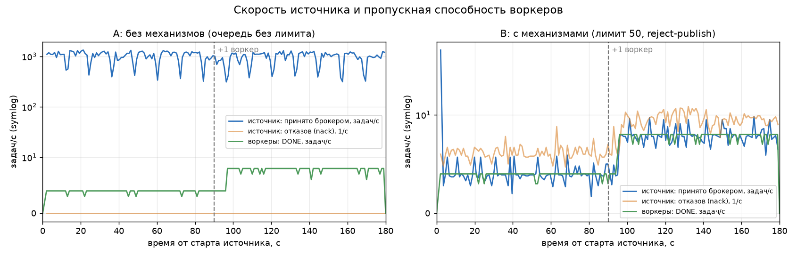
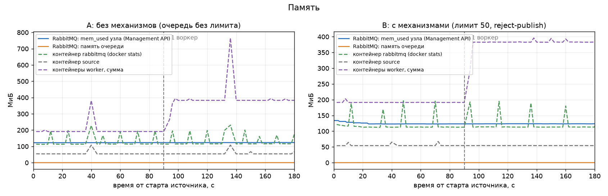

# MLOps MUHA

Платформа для обучения, сравнения и запуска моделей управления виртуальной мухой.
Одна из будущих моделей использует небольшой подграф коннектома FlyWire.

Текущий этап — конвейер задач с противодавлением: источник и `POST /api/v1/tasks` кладут задачи в
ограниченную очередь RabbitMQ, воркеры FastStream выполняют эпизод моделью `champion` из MLflow
(Tracking Server, EDA, отслеживание датасетов, сравнение моделей и Model Registry — предыдущий этап)
и пишут результат в PostgreSQL. Очередь не растёт выше лимита, скорость источника подстраивается
под воркеров, второй воркер подключается без изменения кода; см. «Конвейер задач и противодавление».

## Запуск

Нужны Docker Desktop с работающим Linux Engine и Docker Compose v2.
Для запуска Python вне Docker нужны Python 3.12 и [uv](https://docs.astral.sh/uv/getting-started/installation/).
В проекте и CI используется uv 0.13.5; версии Python-пакетов зафиксированы в `uv.lock`.

```powershell
Copy-Item .env.example .env
# Укажите свои POSTGRES_PASSWORD, MLFLOW_DB_PASSWORD, MINIO_ROOT_PASSWORD и RABBITMQ_PASSWORD в .env (только для локальной разработки).
docker compose up --build --wait
docker compose ps
```

API: [localhost:8000](http://localhost:8000/docs). MLflow UI: [localhost:5000](http://localhost:5000).
Консоль MinIO: [localhost:9001](http://localhost:9001). RabbitMQ Management UI: [localhost:15672](http://localhost:15672)
(логин `RABBITMQ_USER`, пароль `RABBITMQ_PASSWORD` из `.env`). PostgreSQL приложения: `localhost:5432`.
Первый запуск занимает 2–3 минуты: MLflow применяет миграции к своей БД.
Порты опубликованы только на loopback. В контейнерной сети приложение обращается к `db:5432`.
Данные PostgreSQL хранятся в именованном volume и сохраняются при `docker compose down`.

```powershell
Invoke-RestMethod http://localhost:8000/healthz
Invoke-RestMethod http://localhost:8000/api/v1/version
Invoke-RestMethod http://localhost:8000/api/v1/health
docker compose logs --tail 30 app
docker compose down
```

Если порт занят, задайте `APP_PORT`, `POSTGRES_PORT`, `MLFLOW_PORT`, `MINIO_PORT` или
`MINIO_CONSOLE_PORT`, `RABBITMQ_PORT` или `RABBITMQ_MANAGEMENT_PORT` в `.env`.
После изменения пароля уже инициализированного PostgreSQL недостаточно поменять `.env`:
существующая БД сохраняет прежний пароль. Используйте исходный пароль либо измените его в БД.
Команда `docker compose down --volumes` удаляет данные; она нужна только для сброса тестовой БД.

## Разработка и тесты

```powershell
uv sync --locked --group web --group train
uv run --locked pre-commit install
docker compose up -d --wait db
uv run --locked --group web uvicorn agent_platform.main:app --reload --no-access-log
```

Приложение читает `.env` и переменные окружения; окружение имеет приоритет.
Без доступной БД сервер всё равно стартует, а `/healthz` и `/api/v1/version` отвечают.
Секреты не должны попадать в Git: `.env` игнорируется, `.env.example` содержит только пример.
Пароль передаётся SQLAlchemy отдельным значением, поэтому символы `@`, `/` и `:` допустимы.

```powershell
uv run --locked ruff check .
uv run --locked ruff format --check .
uv run --locked pre-commit run --all-files
uv run --locked --group web --group train pytest --cov=agent_platform --cov-report=term-missing --cov-report=xml
```

Без `RUN_INTEGRATION=1` тест с настоящей БД пропускается. Для полного прогона:

```powershell
docker compose up -d --wait db
$env:RUN_INTEGRATION = "1"
uv run --locked --group web --group train pytest --cov=agent_platform --cov-report=term-missing --cov-report=xml
Remove-Item Env:RUN_INTEGRATION
```

В Bash вместо `$env:RUN_INTEGRATION = "1"` используйте `export RUN_INTEGRATION=1`.
Coverage учитывает ветвления; минимальный порог — 85%. XML-отчёт — `coverage.xml`.
Тесты проверяют успех, ошибку и таймаут БД, отмену запроса, работу liveness во время
ожидания БД, освобождение движка, версию пакета, валидацию настроек и отсутствие секретов в логах.
Интеграционный тест проходит через HTTP API, SQLAlchemy, asyncpg и настоящий PostgreSQL.

Ruff: `E4/E7/E9` и `F` — ошибки Python; `I` — порядок импортов; `UP` — современные
конструкции Python 3.12; `B` — распространённые ошибки; `ASYNC` — подозрительные блокирующие
операции в асинхронном коде. Ruff format задаёт единый стиль с длиной строки 100.
Pre-commit запускает те же версии Ruff из `uv.lock`, проверяет YAML/TOML/JSON,
конфликты, приватные ключи, регистр имён файлов, размер файлов, EOF и пробелы.
Hook устанавливается отдельно на каждой машине; CI повторяет эти проверки.

## Контракт API

| Метод и путь | Назначение | Ответ |
| --- | --- | --- |
| `GET /healthz` | Быстрая liveness-проверка процесса без обращения к БД | `200 {"status":"ok"}` |
| `GET /api/v1/version` | Идентификация установленной сборки | `200 {"version":"0.1.0","commit":"..."}` |
| `GET /api/v1/health` | End-to-end проверка PostgreSQL | `200`, либо `503` при проблеме |
| `POST /api/v1/tasks` | Поставить задачу (`seed`, `max_steps`) в очередь | `202` + `Location`, `422`, `503` + `Retry-After` |
| `GET /api/v1/tasks/{task_id}` | Статус задачи, результат и версия модели | `200`, `404`, `422` |

`/healthz` — служебный стабильный адрес для инфраструктуры, поэтому он вынесен
из версионированного пользовательского API. Docker healthcheck использует его;
для проверки готовности обслуживать запросы с БД используйте `/api/v1/health`.
`depends_on: service_healthy` обеспечивает начальный порядок запуска, а не постоянный мониторинг БД.

В `/api/v1/health` SQL-запрос `SELECT current_setting('server_version')` получает
**версию сервера PostgreSQL**, а не драйвера. Время `response_time_ms` измеряется
через `perf_counter` и включает получение соединения из пула, подключение, запрос
и возврат соединения. `HEALTH_TIMEOUT_SECONDS` (по умолчанию 2 секунды, максимум 30)
ограничивает эту операцию. При ошибке возвращаются `version: null` и категория
`unavailable` либо `timeout`. Эта проверка охватывает только PostgreSQL; состояние модели видно в логах воркера и в `tasks.model_version`.

```json
{
  "status": "ok",
  "components": {
    "postgresql": {
      "status": "ok",
      "version": "17.6 (Debian ...)",
      "response_time_ms": 2.31,
      "error": null
    }
  }
}
```

**Версия API `v1`, версия приложения `0.1.0` и версия PostgreSQL — разные величины.**
Единственный источник версии приложения — `[project].version` в `pyproject.toml`.
Приложение получает её через `importlib.metadata.version("agent-platform")` из установленного
пакета, включая Docker. `APP_COMMIT` передаётся при сборке образа; локально допустим `unknown`.
Версия не задаётся независимо в обработчике, переменной окружения или имени API.

## MLflow

### Архитектура

```text
клиенты (пайплайн обучения, приложение, браузер)
        │ только HTTP
        ▼
MLflow Tracking Server (mlflow:5000)
        ├── Backend Store  → PostgreSQL `mlflow-db`: эксперименты, runs, параметры,
        │                    метрики, датасеты, Model Registry
        └── Artifact Store → MinIO, bucket `mlflow`: графики, parquet, файлы моделей
```

| Сервис | Роль |
| --- | --- |
| `mlflow` | Tracking Server и UI, образ из `mlflow/Dockerfile`, MLflow 3.18.0 |
| `mlflow-db` | Backend Store: отдельный PostgreSQL со своим volume и паролем |
| `minio`, `minio-init` | Artifact Store (S3 API) и одноразовое создание bucket |
| `pipeline` | Контейнер обучения, запускается только с профилем `train` |

Решения и их причины:

- **Отдельный контейнер `mlflow-db`**, а не вторая база в `db`: метаданные экспериментов и данные
  приложения не делят ни диск, ни пароль, ни отказ.
- **Проксирование артефактов** (`--serve-artifacts --artifacts-destination s3://mlflow`, корень
  `mlflow-artifacts:/`): клиенты ходят только по HTTP в Tracking Server, ключи MinIO есть лишь у
  сервера. Приложению и пайплайну достаточно `MLFLOW_TRACKING_URI`.
- **`--allowed-hosts`**: MLflow 3 по умолчанию отклоняет запросы с чужим заголовком `Host`.
  Разрешены `localhost`, `127.0.0.1` и имя сервиса `mlflow`; проверка не отключена.
- **`--workers 1` и `MLFLOW_SERVER_ENABLE_JOB_EXECUTION=false`**: с двумя воркерами и фоновыми
  задачами сервер не укладывался в лимит памяти 512 МБ; трекингу и реестру они не нужны.
- **Образы MinIO из `bitnamilegacy`**: официальные `minio/minio` и `minio/mc` больше не
  публикуются. Версии закреплены, но не обновляются; для продакшена нужен поддерживаемый S3.

### Данные

**Среда.** Арена 10×10, 4–7 круглых препятствий, три действия: вперёд, налево, направо. Seed
полностью определяет эпизод. Наблюдение — 9 чисел: sin и cos угла на еду относительно курса,
расстояние до еды и шесть дальномеров (−90°, −45°, −15°, +15°, +45°, +90°).

**Датасет наблюдений и действий.** Учитель на правилах проходит 800 эпизодов; пары
«наблюдение → действие» делятся **по эпизодам**: 600 в обучение (30 460 строк) и 200 в тест
(10 603 строки). Отдельные 100 seed-ов оставлены для проверки поведения в замкнутом цикле.

**Подграф FlyWire.** Источник — таблица связей FlyWire v783 из репозитория
[philshiu/Drosophila_brain_model](https://github.com/philshiu/Drosophila_brain_model),
закреплённая по SHA коммита. Берутся 400 нейронов с наибольшим числом синапсов и наибольшая сильно
связная компонента их подграфа (вошли все 400): 10 970 связей, 51,6% возбуждающих. Подграф лежит в
`data/flywire/`; URL, sha256 исходного файла и параметры отбора — в `metadata.json`.
Условия использования данных FlyWire перед публикацией нужно проверить на flywire.ai.

### Dataset tracking: source, digest, lineage

| Датасет | Где привязан | Source |
| --- | --- | --- |
| `fly-bc-train` | все runs обучения, контекст `training` | `runs:/<run генерации>/datasets/train.parquet` |
| `fly-bc-test` | все runs обучения, контекст `evaluation` | `runs:/<run генерации>/datasets/test.parquet` |
| `flywire-v783-subgraph` | runs FlyWire (контекст `connectome`) и EDA (контекст `eda`) | URL исходной таблицы с SHA коммита |

- **Source** — откуда данные взяты. Run `generate-dataset` в эксперименте `fly-data` загружает
  parquet-файлы как артефакты и записывает параметры генерации, а source датасета указывает на эти
  артефакты. Встроенного источника «артефакт run» в MLflow 3.18 нет, поэтому зарегистрирован свой
  тип `mlflow_run_artifact`.
- **Digest** — короткий отпечаток содержимого: MD5 от хешей строк pandas, числа строк и имён
  столбцов, обрезанный до 8 символов. MLflow хеширует только первые 10 000 строк, поэтому изменение
  дальше по таблице при том же числе строк digest не заметит. Это отпечаток для сравнения версий,
  а не контроль целостности.
- **Lineage** — цепочка: версия модели → run обучения → датасет (имя и digest) → source →
  run генерации и его параметры (seed-ы, версия среды, параметры учителя).

### EDA

Run `eda` сохраняет в `eda/` графики, `eda_summary.md` и `eda_summary.json`: баланс классов
действий, распределения признаков по действиям, корреляции, длины эпизодов и долю успеха учителя,
примеры траекторий, а для подграфа — распределения степеней и весов и то, как активность
распространяется по шагам. Выводы, на которые опирается обучение:

- классы несбалансированы, поэтому основная метрика — macro F1, а не accuracy;
- сигнал достигает 99% нейронов подграфа к третьему шагу, а к пятому активность выходит на
  неподвижную точку, поэтому сравниваются 2 и 6 шагов распространения.

### Эксперименты и результаты

Эксперимент `fly-behavior-cloning`, одни и те же данные и тестовые эпизоды. Основная метрика —
**macro F1 на тесте**. Вспомогательные: accuracy, log loss, precision/recall/F1 по классам, macro F1
на обучении, время предсказания и поведение в 100 отложенных эпизодах — доля успеха, столкновения,
число шагов. Учитель на этих эпизодах успешен в 96% случаев.

| Run | Модель | Macro F1 тест | Macro F1 обучение | Accuracy | Успех эпизодов | Столкновений | Шагов |
| --- | --- | --- | --- | --- | --- | --- | --- |
| `baseline` | логистическая регрессия на наблюдениях | 0,584 | 0,603 | 0,652 | 0,76 | 18,4 | 76,6 |
| `baseline-gbdt` | градиентный бустинг на наблюдениях | **0,895** | 1,000 | 0,917 | **0,93** | 1,93 | 52,5 |
| `flywire-k2` | FlyWire, 2 шага + логистическая регрессия | 0,818 | 0,894 | 0,836 | 0,82 | 0,0 | 67,0 |
| `flywire-k6` | FlyWire, 6 шагов + логистическая регрессия | 0,831 | 0,894 | 0,845 | 0,80 | 0,0 | 70,1 |

Выводы:

- Слой FlyWire поднимает линейный классификатор с 0,58 до 0,82–0,83 macro F1: фиксированный граф
  даёт нелинейные признаки, которых не хватает логистической регрессии.
- Лучший результат у градиентного бустинга без графа. Учитель — набор пороговых правил, и деревья
  воспроизводят их напрямую; при этом на обучении F1 равен 1,0, то есть модель переобучена.
  `baseline-gbdt` добавлен как контроль: без него нельзя понять, даёт ли выигрыш структура
  коннектома или просто нелинейность.
- Разница между 2 и 6 шагами мала, как и предсказывал EDA.
- Порядок по F1 и по поведению не совпадает: FlyWire-модели не сталкиваются вовсе, но реже
  доходят до еды. Ошибки в замкнутом цикле накапливаются, поэтому эпизоды оцениваются отдельно.

Диагностические артефакты каждого run лежат в `diagnostics/`: матрица ошибок (PNG и CSV), отчёт
по классам, результаты эпизодов и траектории модели рядом с траекториями учителя.

### Model Registry

Каждый run регистрируется как версия модели `fly-policy`; теги версии содержат вариант и ключевые
метрики, версия ссылается на свой run. Alias `champion` получает версия с наибольшим macro F1 на
тесте среди тех, у кого доля успешных эпизодов не более чем на 0,10 ниже, чем у учителя.
Сейчас это версия `baseline-gbdt`. Повторный запуск пайплайна добавляет новые версии.

Модель — `sklearn.Pipeline` со всем необходимым для предсказания (для FlyWire-моделей матрица
графа и проекция входов сохранены внутри), формат сериализации — cloudpickle, поэтому приложению
нужен установленный пакет `agent_platform`.

### Запуск пайплайна

```powershell
# В контейнере, против стенда Compose:
docker compose --profile train run --rm pipeline

# На хосте:
$env:MLFLOW_TRACKING_URI = "http://localhost:5000"
uv run --locked --group web --group train python -m agent_platform.training.pipeline
uv run --locked --group web --group train python -m agent_platform.training.pipeline --stage eda train register
```

Пайплайн и `promote` читают имя модели и alias из `FLY_MODEL_NAME` и `FLY_MODEL_ALIAS`
(по умолчанию `fly-policy` и `champion`); в Compose они берутся из `MODEL_NAME` и `MODEL_ALIAS`.
Этапы: `flywire`, `generate`, `eda`, `train`, `register`. Этапам `eda` и `train` нужен
выполненный `generate` на том же сервере. `--stage flywire --rebuild-flywire` заново скачивает
исходную таблицу (100 МБ) и пересобирает подграф.

## Конвейер задач и противодавление

Работа показывает, как медленный потребитель замедляет быстрый источник без потери задач и без
неограниченного роста очереди.

```text
источник (python -m agent_platform.source) ──┐
                                              ├─► очередь tasks ──► worker(ы) ──► PostgreSQL: tasks
POST /api/v1/tasks (API, внешний клиент)  ───┘   (classic, x-max-length=50,        (PENDING → DONE)
                                                   reject-publish)    └─ при ошибке: tasks.dlq
```

- **Источник** лениво генерирует записи и публикует их по одной, дожидаясь подтверждения брокера
  (publisher confirm). Это отдельный процесс; с воркером его связывает только RabbitMQ.
- **Воркер** (FastStream) один раз при старте загружает модель `MODEL_NAME@MODEL_ALIAS` из MLflow,
  берёт задачи из очереди, выполняет эпизод и пишет результат в таблицу `tasks`
  (`task_id`, `status` `PENDING|DONE`, `result`, `model_version`, `enqueued_at`, `started_at`,
  `finished_at`). Длительность задачи — `INFERENCE_SECONDS` (0.5 с): если эпизод посчитался быстрее,
  воркер досыпает остаток.
- **API**: `POST /api/v1/tasks` (`{"seed": 7, "max_steps": 50}`) → `202` + `Location`;
  `GET /api/v1/tasks/{id}` → статус и результат; при переполненной очереди — `503` (ниже).

Параметры (`.env`; значения должны быть одинаковы у API, воркера и источника — очередь, объявленную
с другими аргументами, брокер отвергает): `TASKS_QUEUE=tasks`, `QUEUE_MAX_LENGTH=50` (0 — без
лимита), `TASK_DELIVERY_LIMIT=3`, `INFERENCE_SECONDS=0.5`, `WORKER_CONCURRENCY=2`,
`PUBLISH_TIMEOUT_SECONDS=2`.

### Запуск

```powershell
docker compose up --build --wait                              # app, 1 worker, RabbitMQ, MLflow, PostgreSQL
docker compose up -d --scale worker=2 --no-recreate worker     # второй воркер без изменения кода
docker compose --profile load run --rm source --count 2000 --max-steps 10 --batch-id demo
docker compose --profile load run -d --name src source --count 100000 --max-steps 10
Invoke-RestMethod -Method Post http://localhost:8000/api/v1/tasks -ContentType application/json -Body '{"seed": 7}'
```

RabbitMQ Management UI: [localhost:15672](http://localhost:15672) (логин и пароль — `RABBITMQ_USER`
и `RABBITMQ_PASSWORD` из `.env`), Queues → `tasks`: `Ready` — ожидающие задачи, `Unacked` — задачи
в работе у воркеров. Источник принимает `--count`, `--start-seed`, `--batch-id`
(`task_id = uuid5(batch_id:seed)`: повторный запуск того же батча не создаёт дублей) и
`--max-steps`. Аргументы после имени сервиса заменяют аргументы по умолчанию из Compose
(`--count 100000 --max-steps 10`), поэтому `--max-steps 10` указывайте явно (почему — ниже).

### Брокер → воркер: `prefetch_count = WORKER_CONCURRENCY = 2`

Одна настройка `WORKER_CONCURRENCY` задаёт три величины: `prefetch_count` канала (сколько
неподтверждённых сообщений брокер выдаст воркеру), число одновременно обрабатываемых сообщений и
размер пула потоков для inference. Пропускная способность воркера — `2 / 0.5 с = 4 задачи/с`,
`N` воркеров дают `N * 4`.

- `prefetch > N`: лишние сообщения лежат в буфере воркера — они недоступны второму воркеру,
  удлиняют ожидание задачи и при падении воркера уходят на повторную доставку.
- `prefetch < N`: потоки простаивают, пропускная способность ниже возможной. Проверено:
  при `WORKER_CONCURRENCY=1` в UI `Unacked = 1`, воркер завершает 1.97 задач/с вместо 3.93 при `2`.
- `prefetch = N`: пока обрабатывается задача длиной `t`, следующая уже лежит в буфере, поэтому после
  подтверждения воркер получает её за время обмена с брокером RTT. Утилизация
  `t / (t + RTT) ≈ 99.8%` при `t = 0.5 с` и RTT порядка 1 мс.

Inference — синхронные вычисления, поэтому он выполняется в пуле потоков и не блокирует event
loop. Проверено: при полностью загруженном воркере `GET /healthz` (порт 8001 внутри контейнера, тот же
event loop) отвечает `200` за 22–24 мс (5 запросов подряд).

**Условие: вычисление эпизода должно быть короче `INFERENCE_SECONDS`.** Два потока делят один GIL и
контейнер с `cpus: 1.0`. Замер внутри воркера: эпизод при `max_steps=200` занимает 0.14 с в одном
потоке и в среднем 0.91 с, когда два потока работают одновременно (при `max_steps=10` — 0.03 с и
0.19 с). Поэтому при `max_steps=200` воркер завершал около 2 задач/с на один контейнер вместо 4
(первый, отброшенный прогон эксперимента), а все числа ниже получены с `--max-steps 10`: тогда
время задачи определяют `0.5 с`, и теоретическая пропускная способность `workers * 2 / 0.5`
достигается.

### Воркер → источник: ограниченная очередь и publisher confirms

Очередь `tasks` — durable **classic** с `x-max-length=50` и `x-overflow=reject-publish`;
публикация идёт с подтверждениями. Когда очередь заполнена, брокер отвечает на публикацию
`nack`; источник ловит его (`QueueFullError`), ждёт экспоненциальную задержку
(0.05 с, ×2, потолок 1 с, джиттер до 20%) и повторяет **ту же** задачу. Новые записи пока не
генерируются, поэтому в памяти источника ровно одна задача, а его скорость сама подстраивается под
скорость разбора очереди. Потолок задержки 1 с меньше времени разбора очереди (`50 / 4 = 12.5 с`), так
что освободившееся место занимается не позже чем через секунду. Раз в секунду источник пишет
`source_progress published_total=.. rejected_total=.. rate_per_s=..`.

Лимит относится к ожидающим (`ready`) сообщениям. Сообщения в работе (`unacked`) в него не входят: их
не больше `workers * WORKER_CONCURRENCY`. Сообщения, возвращённые в очередь после падения воркера,
лимит тоже обходят (ниже: `ready` доходил до 52).

**Почему classic, а не quorum.** Quorum-очередь (RabbitMQ 4.1.8) не держит лимит при
`reject-publish`: при лимите 5 она принимала 6 из 12 сообщений при последовательной публикации, 20 при
параллельной и 80 при 100-кратной параллельности, потому что лимит применяется асинхронно. Classic
держит лимит точно (5/5/5). Цена: у classic-очереди нет счётчика доставок (`x-delivery-limit`),
повторы считает воркер (ниже).

**Отвергнутые варианты.**

| Вариант | Почему не подходит |
| --- | --- |
| Опрос глубины очереди через Management API | статистика обновляется раз в ~5 с; лишняя нагрузка на брокер; гонка между проверкой и публикацией (несколько источников проходят проверку одновременно); зависимость от HTTP-плагина |
| Фиксированная частота | это rate limiting, он не подстраивается под число воркеров и длительность задачи: второй воркер ничего бы не дал |
| `drop-head`, `reject-publish-dlx` | теряют (`drop-head`) или выбрасывают в DLX (`reject-publish-dlx`) задачи, которые источник уже считает принятыми |
| Глобальный flow control / memory alarm RabbitMQ | блокирует все соединения, включая API и воркеры; срабатывает поздно и по памяти, а не по длине очереди |
| Внутренний буфер источника | память источника неограниченно растёт: проблема лишь переезжает |

### Граница системы: `503` при переполнении

`POST /api/v1/tasks` делает **одну** попытку публикации. Если брокер отверг её (`QueueFullError`) или
недоступен, API сразу отвечает `503 {"error":"queue_full"}` (или `broker_unavailable`) с заголовком
`Retry-After = max(1, ceil(QUEUE_MAX_LENGTH * INFERENCE_SECONDS / WORKER_CONCURRENCY))` — 13 с при
значениях по умолчанию. Это время разбора полной очереди одним воркером: раньше повторять запрос
бессмысленно, освободившиеся места займут другие, а принятая сейчас задача всё равно прождёт столько
же.

Это **load shedding**, а не backpressure: внешнего клиента нельзя замедлить или заставить ждать —
он вне контура. Мы отбрасываем лишнюю работу на входе и сообщаем, когда повторить. Backpressure —
когда медленный этап замедляет быстрый внутри системы (как воркер и источник выше).

Запись `PENDING` в БД создаётся только после подтверждения брокера, поэтому отклонённые запросы не
оставляют записей. Проверено при очереди, которую источник держал полной: из 20 `POST` 16 вернули
`503` с `Retry-After: 13` (время ответа до 23 мс), 4 — `202` (слот освободил воркер раньше, чем
источник вышел из паузы); новых `PENDING` в БД ровно 4, по числу `202`.

### Надёжность

**Подтверждения (`ack_policy=REJECT_ON_ERROR`).** Сообщение подтверждается после записи результата
в БД; при исключении оно отклоняется без возврата в очередь и по dead-letter-аргументам очереди
попадает в `tasks.dlq`. Альтернативы:

| Политика | Последствие |
| --- | --- |
| `ACK_FIRST` | подтверждение до обработки: падение воркера теряет задачу |
| `ACK` | подтверждение и при ошибке: упавшая задача теряется |
| `NACK_ON_ERROR` | возврат в очередь при любой ошибке: на classic-очереди нет счётчика доставок, поэтому без собственного счётчика задача, которая всегда падает, возвращалась бы бесконечно. Возврат нужен только до лимита, поэтому `nack` и `reject` выбираются в обработчике (`NackMessage`/`RejectMessage`) |
| `MANUAL` | тот же результат, что у `REJECT_ON_ERROR`, но больше кода |

**Ограниченное число доставок.** Classic-очередь не считает доставки, поэтому счётчик ведёт
Postgres: таблица `task_deliveries(task_id, deliveries)`, в начале обработки каждой доставки один
оператор `INSERT ... ON CONFLICT (task_id) DO UPDATE SET deliveries = deliveries + 1 RETURNING
deliveries`. Пусть `n` — номер доставки, `TASK_DELIVERY_LIMIT=3`:

- `n > лимита` — сообщение сразу отклоняется без возврата в очередь (`tasks.dlq`), задача не
  выполняется;
- ошибка при `n < лимита` — `nack` с возвратом в очередь: брокер доставляет сообщение повторно;
- ошибка при `n == лимита` — `reject` без возврата, сообщение уходит в `tasks.dlq`;
- успех — результат записан в БД, затем `ack`.

Счёт учитывает и доставки после падения процесса: сообщение, которое убивает воркер (OOM, SIGKILL),
после `TASK_DELIVERY_LIMIT` доставок уходит в DLQ при следующей доставке, не выполняясь. Если сам
счётчик не обновился (БД недоступна), сообщение отклоняется без возврата. Невалидное сообщение
(не JSON, `seed=-1` и т. п.) отклоняется сразу: повтор его не исправит.

**Идемпотентность.** Результат пишется одним оператором `INSERT ... ON CONFLICT (task_id) DO UPDATE ...
WHERE status = 'PENDING'` — без «проверить, затем вставить». Повторная обработка уже выполненной
задачи не создаёт второй строки и не перезаписывает результат (`written=False` в логе).

**Graceful shutdown.** `init: true` и `stop_grace_period: 30s` в Compose, `graceful_timeout =
INFERENCE_SECONDS * 2 + 5` в воркере: по SIGTERM воркер доделывает уже взятые задачи (результат
демонстрации — ниже). Задача, взятая воркером до сигнала, дописывается и подтверждается; сообщения,
которые брокер ещё не выдал, остаются в очереди.

### Эксперимент

Одинаковое расписание для обоих сценариев: `t = 0` — один воркер и источник; `t = 90 с` —
`docker compose up -d --scale worker=2 --no-recreate worker`; `t = 180 с` — остановка источника.
Сценарий **A** («без механизмов»): `TASKS_QUEUE=tasks-unbounded`, `QUEUE_MAX_LENGTH=0` — очередь без
лимита, источник не получает отказов. Сценарий **B** («с механизмами»): `QUEUE_MAX_LENGTH=50`.
В обоих `--max-steps 10` (см. выше), `INFERENCE_SECONDS=0.5`, `WORKER_CONCURRENCY=2`.

```powershell
uv run python scripts/experiment.py run --label A --queue tasks-unbounded --max-length 0 --batch-id exp-a
uv run python scripts/experiment.py cleanup --queue tasks-unbounded
uv run python scripts/experiment.py run --label B --queue tasks --max-length 50 --batch-id exp-b
uv run --group train python scripts/plot_experiment.py
```

`scripts/experiment.py` раз в секунду читает глубину и память очереди из Management API, раз в ~2 с —
память контейнеров из `docker stats`; скорость источника берёт из его логов `source_progress`; число
`DONE` в секунду и время выполнения — из таблицы `tasks`. Опрос Management API — только измерение:
источник им не пользуется, его скоростью управляют подтверждения брокера. Данные лежат в
`docs/backpressure/*.csv`. Статистика очередей в Management API обновляется раз в ~5 с, поэтому
графики глубины ступенчатые.

| Сценарий | Воркеры | Теория, задач/с | Источник, задач/с | DONE, задач/с | Макс. ready | Макс. unacked | RabbitMQ mem_used, МиБ | В системе: медиана, с | В системе: p95, с | inference: медиана, с |
| --- | --- | --- | --- | --- | --- | --- | --- | --- | --- | --- |
| A | 1 | 4 | 1002.1 | 3.93 | 82883 | 2 | 123–123 | 58.47 | 85.52 | 0.50 |
| A | 2 | 8 | 986.0 | 7.87 | 166743 | 4 | 123–124 | 147.92 | 174.85 | 0.50 |
| B | 1 | 4 | 3.9 | 3.95 | 50 | 2 | 123–123 | 13.06 | 13.21 | 0.50 |
| B | 2 | 8 | 7.9 | 7.87 | 50 | 4 | 123–124 | 6.79 | 6.87 | 0.50 |

Окна установившегося режима: 30–90 с (один воркер) и 120–180 с (два воркера: после запуска второму
нужно около 10 с на загрузку модели). Итоги прогонов: A — источник принял 176 172 задачи, отказов 0,
обработано 1 031, в конце в очереди 171 683; B — принято 1 082, отказов (`nack`) 1 390, обработано
1 037, `ready` за весь прогон не больше 50, `unacked` не больше 4. Расхождения в несколько задач между
принятыми, обработанными и оставшимися в очереди — запаздывание статистики Management API.






Выводы по пунктам ТЗ:

- **Глубина очереди.** B: `ready` не превышает лимит 50 на протяжении всего прогона, в том числе
  после запуска второго воркера (`unacked` — ещё 2–4 задачи в работе). A: очередь растёт линейно,
  ≈950 задач/с, и к 180 с достигает 171 683.
- **Скорость источника.** B: в установившемся режиме равна пропускной способности воркеров — 3.9
  против 3.95 задач/с с одним воркером и 7.9 против 7.87 с двумя. Источник сам подстроился под
  потребителя; излишек превращается в отказы (1 390 `nack` за прогон). A: источник публикует
  ≈1 000 задач/с независимо от числа воркеров, в 125–250 раз быстрее, чем воркеры разбирают.
- **Второй воркер.** Пропускная способность выросла с 3.95 до 7.87 задач/с, скорость источника в B —
  с 3.9 до 7.9, без изменения кода, одной командой `--scale worker=2`; теория — 4 и 8 задач/с.
  В A второй воркер тоже удвоил пропускную способность, но очередь продолжала расти.
- **Время выполнения задачи.** Время самого inference одинаково (0.50 с). Время в системе
  (`finished_at - enqueued_at`) в B ограничено временем разбора полной очереди: 13.06 с с одним
  воркером (≈ 50 / 4 + 0.5) и 6.79 с с двумя; в A оно растёт линейно вместе с очередью (медиана 58 с в
  окне одного воркера и 148 с в окне двух, p95 — до 175 с).
- **Память.** Память не стала узким местом: `mem_used` узла RabbitMQ в A практически не менялась
  (123–124 МиБ при 171 тыс. сообщений в очереди), память источника (≈54 МиБ) и воркера (≈191 МиБ)
  в обоих сценариях постоянна. Рост памяти от неограниченной очереди за 3 минуты этим экспериментом
  не показан (вероятно, короткие persistent-сообщения classic-очереди уходят на диск; диск не
  измерялся). Цена неограниченной очереди в A — время ожидания, а не память.
- **Потери.** В B ни одной задачи не потеряно: батчи из демонстраций ниже завершились 100/100 и
  300/300 `DONE`, `tasks.dlq` пуст.

### Результаты демонстраций

Проверки выполнены на сценарии B (лимит 50). Для надёжности использовался конечный батч
(`--count 300 --max-steps 10`), число выполненных задач батча сверялось запросом
`count(*) ... WHERE status='DONE' AND task_id = ANY(uuid5(batch:seed))`.

| Проверка | Результат |
| --- | --- |
| Health под нагрузкой | `GET /healthz` воркера: `200`, 22–24 мс (5 из 5) |
| Graceful shutdown (один воркер, `INFERENCE_SECONDS=5`, батч из 6 задач, `docker kill -s SIGTERM` через ≈1 с после того, как воркер взял первые 2 задачи) | контейнер вышел через 3.8 с после сигнала с кодом 143 — то есть дождался задач, а не оборвал их: в логах после метки времени сигнала (`03:18:50.44`) есть `task_done` для обеих взятых задач (`8c0d2ed0-…`, `25a48836-…`, `03:18:54.03`). Оставшиеся 4 сообщения лежали в `ready` (выданы не были), `redeliver` не вырос (9 → 9). После `docker compose up -d worker` остальные 4 выполнены; `DONE` у всех 6, `deliveries = 1` у каждой (не было ни одной повторной доставки), `written=False` нет |
| `SIGKILL` (один воркер, `INFERENCE_SECONDS=5`, 1 задача, сигнал через ≈1 с после взятия в работу) | контейнер вышел с кодом 137, `deliveries = 1`, строки в `tasks` ещё нет. После `docker compose up -d worker` брокер доставил сообщение повторно: задача `DONE`, `deliveries = 2`, в `tasks` одна строка. Потерь и дублей нет |
| Некорректные сообщения | через Management API (`POST /api/exchanges/%2F/amq.default/publish`, `routing_key=tasks`) отправлены `this is not json {{` и корректный JSON с `seed=-1`; оба оказались в `tasks.dlq` (причина `rejected`), строк в БД не появилось, батч из 100 задач завершился 100/100 |
| Смена лимита политикой | `max-length: 20` → `ready` держался на 20 (выборка раз в 2 с: 0 0 20 20 18 18 20 20 20 20); после `clear_policy` — снова 50 |
| Смена `prefetch_count` | `WORKER_CONCURRENCY=1` → `Unacked = 1`, 59 `DONE` за 30 с (1.97/с); `WORKER_CONCURRENCY=2` → `Unacked = 2`, 118 за 30 с (3.93/с) |
| `503` при полной очереди | 16 из 20 запросов — `503` + `Retry-After: 13`, до 23 мс; 4 — `202`; новых `PENDING` ровно 4 |

`docker kill` не приводил к автоматическому перезапуску контейнера (`RestartCount=0`).

### Инструкция для защиты

1. `docker compose up -d --wait`, открыть Management UI → Queues → `tasks`.
2. **Лимит и скорость источника:**
   `docker compose --profile load run -d --name src source --count 100000 --max-steps 10`.
   `Ready` поднимается до 50 и стоит там; в `docker compose logs -f src` растёт `rejected_total`,
   `rate_per_s` ≈ 4 (скорость одного воркера).
3. **Второй воркер:** `docker compose up -d --scale worker=2 --no-recreate worker` — `rate_per_s`
   растёт до ≈8, в UI два consumer'а, `Unacked = 4`.
4. **Смена лимита без изменения кода** (действует меньшее из значений):
   `docker compose exec rabbitmq rabbitmqctl set_policy queue-limit "^tasks$" '{"max-length":20}' --apply-to queues`
   (или Management UI → Admin → Policies); вернуть — `rabbitmqctl clear_policy queue-limit`.
   Политикой лимит можно только уменьшить. Чтобы увеличить, поменяйте `QUEUE_MAX_LENGTH` в `.env`,
   удалите очередь `tasks` (Queues → Delete) и пересоздайте сервисы:
   `docker compose up -d --force-recreate app worker`.
5. **`prefetch_count`:** `$env:WORKER_CONCURRENCY = 1; docker compose up -d --no-deps --force-recreate worker`
   — у воркера `Unacked = 1`, `rate_per_s` вдвое ниже. Вернуть: `Remove-Item Env:WORKER_CONCURRENCY` и та же команда.
6. **Падение воркера:** `docker kill -s SIGKILL <контейнер воркера>` (имя — `docker compose ps worker`):
   `Unacked` возвращается в `Ready`, в БД нет ни потерь, ни дублей. Для остановки с доделыванием
   задач — `-s SIGTERM`.
7. **Некорректное сообщение:** Queues → `tasks` → Publish message → payload `not json`; сообщение
   появляется в `tasks.dlq`, остальные задачи продолжают выполняться.
8. **`503`:** при работающем источнике
   `curl -i -X POST http://127.0.0.1:8000/api/v1/tasks -H "Content-Type: application/json" -d '{"seed":1,"max_steps":10}'`.

### Тесты

- Модульные (быстрые; брокер подменён `TestRabbitBroker`): топология и аргументы очереди, publisher
  confirms и преобразование `nack` в `QueueFullError`, экспоненциальная задержка источника и повтор
  той же задачи, `enqueued_at` на каждой попытке, ленивая генерация и детерминированные `task_id`,
  воркер (ack после записи; `nack` с возвратом до лимита доставок, `reject` на последней доставке и без запуска после неё, ошибка счётчика, невалидное сообщение, inference в потоках без блокировки
  event loop, один параметр для prefetch и пула), API (`202`, `503` + `Retry-After`, ничего в БД при
  отказе, `GET`).
- Интеграционные (настоящие RabbitMQ и PostgreSQL в Testcontainers, нужен Docker):
  `RUN_INTEGRATION=1 uv run --locked --group web --group train pytest -m integration`. Проверяют, что
  полная очередь не превышает лимит и каждая задача доставлена один раз, что всегда падающий
  потребитель оказывается в DLQ ровно после `TASK_DELIVERY_LIMIT` доставок (счётчик в Postgres
  совпадает), что сообщение, которое «убивает» потребителя (соединение закрыто без `ack`), после
  лимита доставок уходит в DLQ без выполнения, что нечитаемое сообщение попадает в DLQ без записи
  в БД, идемпотентность объявления топологии и записи результата, а также что `PENDING` не откатывает уже
  готовую задачу.

### Смена версии модели

```powershell
$env:MLFLOW_TRACKING_URI = "http://localhost:5000"
uv run --locked --group web --group train python -m agent_platform.training.promote              # состояние реестра
uv run --locked --group web --group train python -m agent_platform.training.promote --version 3  # champion → версия 3
docker compose restart worker
docker compose logs --tail 5 worker                                                              # worker_started ... model_version 3
```

Alias можно переключить и в MLflow UI. До перезапуска воркер продолжает работать со старой
версией; код inference при смене версии не меняется. Версия модели каждой задачи записана в
`tasks.model_version`.

**Ограничения такого обновления.** Перезапуск единственного воркера — это пауза в обработке
(очередь при этом копится до лимита и источник замедляется, а не теряет задачи). Новая версия
начинает обрабатывать все задачи сразу, без проверки на их части. Если новая версия не загрузится,
воркер не стартует. Несколько воркеров, перезапущенных в разное время, какое-то время работают на
разных версиях. Откат — это ещё одно переключение alias и ещё один перезапуск.

Как сделать лучше: обновлять воркеры по одному (rolling update) с readiness-проверкой, которая
пускает задачи только после загрузки модели и пробного предсказания; новую версию сначала проверять
на малой доле задач (canary) или в теневом режиме под alias `challenger`; закреплять в деплое
конкретную версию, а alias использовать только как указатель «что выкатывать следующим», чтобы
перезапуск не менял модель незаметно.

## Устройство проекта

```text
src/agent_platform/
  main.py             # Фабрика FastAPI, lifespan, создание и dispose движка
  api/                # Маршруты и модели HTTP-ответов
  core/               # Настройки, версия пакета, JSON-логи и request ID
  db/                 # Async SQLAlchemy + asyncpg и запрос версии сервера
  sim/                # Среда (2D-мир), учитель и запуск эпизода
  ml/                 # ConnectomeFeatures (слой FlyWire) и загрузка модели из MLflow
  messaging.py        # Топология RabbitMQ (очередь, DLX/DLQ), публикация с confirms
  source.py           # Источник задач с экспоненциальной задержкой при отказах брокера
  worker.py           # Воркер FastStream: inference в пуле потоков, запись результата
  training/           # Пайплайн: данные, EDA, обучение, Model Registry, promote
data/flywire/         # Подграф FlyWire v783 (400 нейронов) и его metadata.json
mlflow/               # Образ MLflow Tracking Server
tests/                # Unit-тесты и integration/ с настоящими PostgreSQL и RabbitMQ
scripts/              # Smoke-проверка API, проверка тегов, эксперимент с противодавлением и графики
docs/backpressure/    # Данные (CSV) и графики эксперимента
.github/workflows/    # CI, Compose-проверка отказа БД и публикация в GHCR
```

Движок создаётся в lifespan без обязательного подключения и освобождается при остановке.
Все обработчики и сетевые обращения к БД асинхронны. Блокирующих SQL-драйверов,
`time.sleep` в event loop нет; эпизоды воркера и загрузка модели выполняются в потоках.

Приложение пишет JSON в stdout: UTC timestamp, уровень, событие, request ID,
метод, путь, HTTP-статус и время. Ответ содержит `X-Request-ID`.
На старте пишутся версия и SHA; при сбое БД — тип исключения и длительность.
Строка подключения, текст исключения драйвера, query string и тела запросов не логируются.
В Compose включена ротация логов. Uvicorn access log отключён, чтобы не дублировать запросы.

Dockerfile использует отдельные этапы сборки и запуска, слой зависимостей из lock-файла и установку пакета
без editable-режима. Итоговый контейнер содержит только runtime и запускается с UID 10001.
Compose задаёт memory/CPU limits, отдельную сеть, healthchecks, volume, read-only rootfs
для приложения, сброс capabilities и `no-new-privileges`.

## CI/CD и версии образов

[GitHub Actions](https://github.com/Tr1pel/MLOps_MUHA/actions) запускается для PR,
push в `main`, тегов `v*` и вручную. Публикация выполняется только при push в `main`
или релизного тега, после успешных jobs `checks` и `container`.

`checks` проверяет lock-файл, Ruff, форматирование, pre-commit и pytest с coverage,
поднимая PostgreSQL как service container. Отчёт покрытия сохраняется как artifact.
`container` собирает Compose и проверяет три ручки, останавливает БД, проверяет
`/healthz=200` и `/api/v1/health=503`, затем запускает БД и проверяет восстановление.
Ошибка любого из этих этапов блокирует публикацию.

| Событие | Результат |
| --- | --- |
| Pull request | CI и контейнерные проверки без публикации |
| Push в `main` | `ghcr.io/tr1pel/mlops_muha:sha-<полный SHA>` |
| Push `v0.1.0` | SHA-тег и `ghcr.io/tr1pel/mlops_muha:0.1.0` |
| Ручной запуск | Только проверки |

Каждый push основной ветки даёт проверяемую сборку, связанную с точным коммитом.
Релизный тег обозначает намеренно выбранную версию. Допустим формат `vMAJOR.MINOR.PATCH`;
несовпадение тега и версии пакета останавливает публикацию. Тег `latest` не используется.
Перед новым релизом измените `[project].version`, выполните `uv lock`, проверки и коммит.

```powershell
git push origin main
git tag v0.1.0
git push origin v0.1.0
```

GHCR использует встроенный `GITHUB_TOKEN` с `packages: write` только в job публикации.
Персональный токен в secrets для workflow не нужен. Actions закреплены по SHA,
версии базовых образов и uv указаны явно. Образ получает OCI labels source, revision,
version, SBOM и provenance. После push pipeline скачивает **опубликованный образ по digest**,
запускает с PostgreSQL и проверяет API, версию и SHA. Ссылка с digest появляется в job summary.
CD в этом задании заканчивается публикацией и проверкой образа; отдельный сервер не нужен.

Для приватного репозитория пакет GHCR следует оставить приватным.
Для скачивания приватного образа с локальной машины нужна авторизация `docker login ghcr.io`
с разрешением `read:packages`; пароль вводите через стандартный безопасный вход,
не добавляйте его в файлы проекта. После входа:

```powershell
$env:APP_IMAGE = "ghcr.io/tr1pel/mlops_muha:0.1.0"
docker compose pull app
docker compose up --no-build --wait
uv run --locked python scripts/smoke.py --version 0.1.0
Remove-Item Env:APP_IMAGE
```
